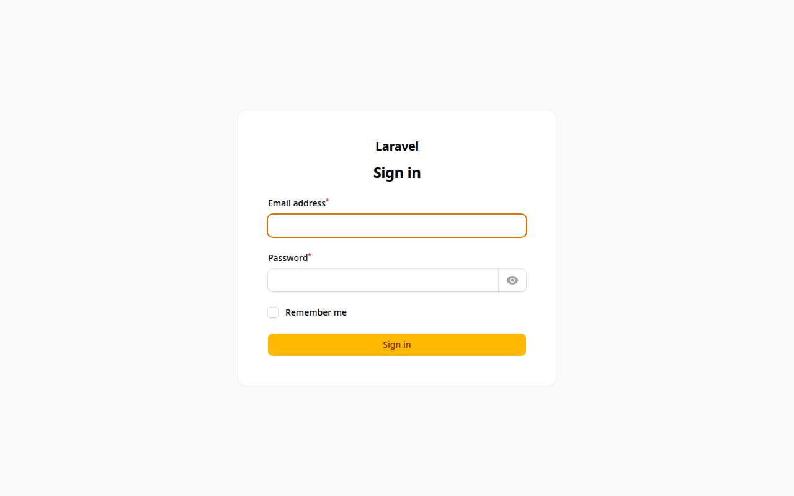

# Menu Digital SaaS

Aplikasi buku menu digital untuk banyak toko yang dibangun dengan Laravel 12. Setiap toko memiliki halaman menu publik sendiri berdasarkan username. Pelanggan dapat melihat produk, memasukkan pesanan ke keranjang, dan membayar melalui Midtrans. Pengelolaan data dilakukan dari panel admin Filament.

## Fitur

- Halaman menu publik per toko pada alamat `/{username}`
- Pencarian produk pada halaman toko
- Halaman detail produk
- Keranjang belanja dan formulir data pelanggan
- Checkout dengan pembayaran Midtrans Snap
- Panel admin Filament untuk kategori produk, produk, transaksi, langganan, dan pengguna
- Data bahan produk pada setiap produk
- Catatan pesanan dan nomor telepon pelanggan pada transaksi
- Model langganan dan pembayaran langganan untuk toko

## Teknologi

- PHP 8.2 atau lebih baru
- Laravel 12
- Filament 4 untuk panel admin
- Midtrans PHP SDK untuk pembayaran
- Laravel Sanctum
- Blade, Vite, dan Tailwind CSS 4
- SQLite sebagai database bawaan

## Cara Instalasi

Prasyarat:

- PHP 8.2 atau lebih baru
- Composer
- Node.js dan npm
- Akun Midtrans bila ingin mencoba pembayaran

Langkah instalasi:

```bash
git clone https://github.com/bintangyudhis/menu-digital-saas.git
cd menu-digital-saas
composer install
npm install
cp .env.example .env
php artisan key:generate
php artisan migrate
php artisan storage:link
```

Kunci server Midtrans diatur pada variabel `MIDTRANS_SERVER_KEY` di file `.env`, sesuai konfigurasi pada `config/midtrans.php`. Tanpa kunci ini, halaman menu tetap dapat dibuka dan pembayaran tidak dapat diproses.

Untuk masuk ke panel admin, buat pengguna terlebih dahulu:

```bash
php artisan make:filament-user
```

## Cara Menjalankan

Jalankan server pengembangan Laravel:

```bash
php artisan serve
```

Halaman menu toko dapat dibuka di `http://localhost:8000/{username}` dengan username toko yang terdaftar. Panel admin ada di `http://localhost:8000/admin`.

## Tangkapan Layar



## Lisensi

Proyek ini memakai lisensi MIT. Lihat berkas [LICENSE](LICENSE) untuk teks lengkapnya.
